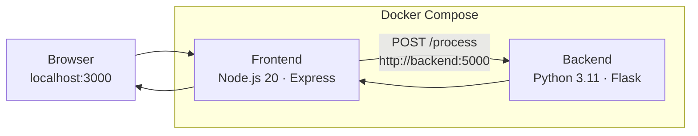

# 2-Tier Docker Compose App

[](https://www.docker.com/)
[](https://nodejs.org/)
[](https://www.python.org/)

A small, full-stack application demonstrating how to run a Node.js/Express frontend and a Python/Flask API as separate Docker containers, connected with Docker-Compose.

The frontend accepts a name and forwards it to the backend over Docker's private service network. The backend returns a greeting, which the frontend displays in the browser.

## Architecture



Compose starts both services on the `frontend-network` bridge network. The frontend reaches the backend using the Compose service name `backend`; no container IP address is hardcoded.

## Tech stack

| Component | Technology | Container port | Purpose |
| --- | --- | ---: | --- |
| Frontend | Node.js 20, Express, Axios | `3000` | Serves the form and sends requests to the API |
| Backend | Python 3.11, Flask | `5000` | Accepts a name and returns a greeting |
| Orchestration | Docker Compose | — | Builds, starts, and connects the services |
| Networking | User-defined bridge network | — | Enables private service-to-service communication |

## Run locally with Docker

### Prerequisites

- [Docker Desktop](https://www.docker.com/products/docker-desktop/) or Docker Engine with the Compose plugin
- [Git](https://git-scm.com/) to clone the repository

Check that Docker and Compose are available:

```bash
docker --version
docker compose version
```

### Start the application

```bash
git clone https://github.com/Tharun-codes/2-tier-docker-compose-app.git
cd 2-tier-docker-compose-app
docker compose up --build
```

Open [http://localhost:3000](http://localhost:3000), enter a name, and submit the form. Compose publishes the backend on port `5000` as well.

To run the containers in the background, add `-d`:

```bash
docker compose up --build -d
```

## API

| Service | Method and path | Description |
| --- | --- | --- |
| Frontend | `GET /` | Serves the name-entry form |
| Frontend | `POST /submit` | Sends the submitted name to the backend |
| Backend | `GET /` | Returns a simple text response |
| Backend | `POST /process` | Accepts a `name` and returns a greeting |

Example backend request:

```bash
curl -X POST http://localhost:5000/process \
  -H "Content-Type: application/json" \
  -d "{\"name\":\"Ada\"}"
```

Example response:

```text
Hello, Ada from Flask!
```

## Useful commands

| Action | Command |
| --- | --- |
| View service status | `docker compose ps` |
| Follow logs | `docker compose logs -f` |
| Follow one service's logs | `docker compose logs -f backend` |
| Stop running services | `docker compose stop` |
| Stop and remove containers and network | `docker compose down` |
| Rebuild images | `docker compose build --no-cache` |

## Project structure

```text
.
├── backend/
│   ├── app.py
│   ├── Dockerfile
│   └── requirements.txt
├── frontend/
│   ├── public/
│   │   └── index.html
│   ├── app.js
│   ├── Dockerfile
│   └── package.json
├── docker-compose.yml
└── README.md
```

## What this project demonstrates

- Separating a web frontend and API into independently built services
- Building container images from Node.js and Python Alpine base images
- Defining service startup and port mappings with Docker Compose
- Connecting containers through a user-defined bridge network
- Using Compose service-name DNS for internal HTTP requests

## Possible next steps

- Add container health checks and explicit readiness handling
- Add automated tests and a continuous integration workflow
- Move service configuration into environment variables
- Add a persistent datastore if the application needs to store data

## Author

**Tharun** · [GitHub](https://github.com/Tharun-codes)
